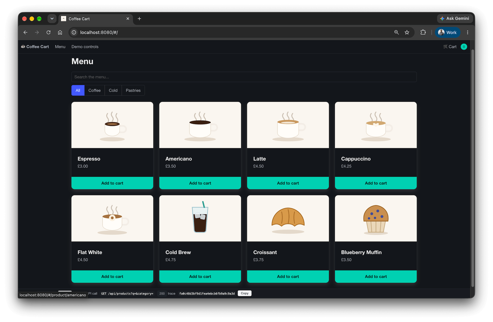
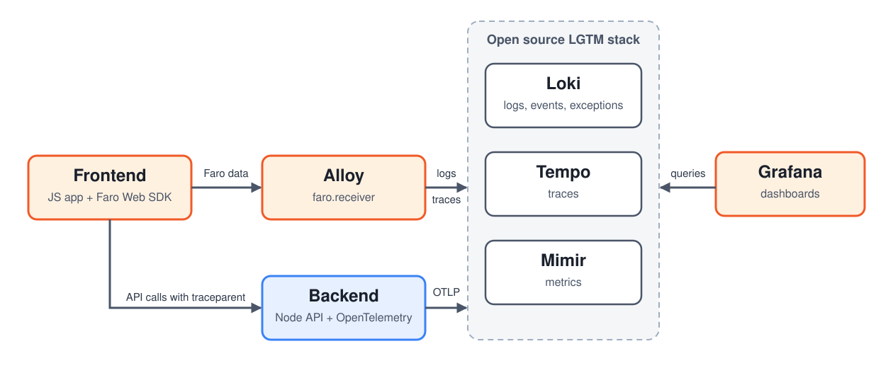

# Introducing Grafana Faro — Coffee Cart demo



A deliberately small demo app for showing [Grafana Faro](https://grafana.com/oss/faro/) (frontend observability) alongside backend OpenTelemetry, so you can follow a single user action from the browser through to the API as one distributed trace.

It is a coffee cart: browse a menu, add things to a cart, check out. There is no real payment and no database. Data is in memory and resets when the backend restarts.

```
Browser (Faro Web SDK + tracing)  ──fetch + traceparent──▶  Backend (Node/Express + OpenTelemetry)
        │                                                          │
        └── Faro collector URL (FARO_URL)                          └── OTLP (OTEL_EXPORTER_OTLP_ENDPOINT)
```

Everything is self-contained: Bulma, Faro and the product illustrations are bundled or served locally, so the app itself works offline. The first run needs internet (to pull the images and build the app); after that, the local setups run with no network at all.

## Quick start

Requires Docker.

```sh
./start.sh local     # the app, plus the local stack (Grafana, Tempo, Loki, Mimir, Alloy)
./start.sh cloud     # the app only, sending its telemetry to Grafana Cloud
./start.sh stop      # stop the app
```

`./start.sh local` works with no setup. It creates `.env.local` from [`.env.local.example`](.env.local.example) the first time. For Grafana Cloud, copy [`.env.cloud.example`](.env.cloud.example) to `.env.cloud` and fill in the values marked REQUIRED (see [Switching between local and Grafana Cloud](#switching-between-local-and-grafana-cloud)).

- Frontend: http://localhost:8080
- API: http://localhost:3000/api/products
- Grafana (local mode): http://localhost:3001 (details in [`observability/README.md`](observability/README.md))
- Alloy UI (local mode): http://localhost:12345

The backend implementation is chosen with `BACKEND` (default `nodejs`, the only one so far). The API and telemetry contract that every implementation follows is in [`backend/README.md`](backend/README.md).

Faro and OTLP telemetry is sent to wherever you point it (see below). If nothing is listening, the app still works; the telemetry is just dropped. Set `FARO_URL=` (empty) to disable Faro completely.

## Running the demo

The demo has three parts, each with one script that starts what it needs, waits until it is ready, prints the URLs, and **stops everything it started when you press Ctrl-C**. Run each in its own terminal, from the repo root. Docker Desktop must be running.

| Part | Start | What runs |
|---|---|---|
| 1. Hello world | `demo/hello.sh` | Grafana and Alloy, plus the [hello page](hello/README.md) on :8081 (no backend) |
| 2. Coffee cart, local | `demo/local.sh` | Grafana and Alloy, plus the app |
| 3. Coffee cart, Grafana Cloud | `demo/cloud.sh` | The app only, sending to Cloud (needs `.env.cloud`) |
| Traffic and errors for part 2 | `demo/traffic.sh` | Synthetic visitors against the running local app ([`traffic/`](traffic/README.md)) |

Parts 1 and 2 share Grafana and Alloy, so to run both at once start `demo/hello.sh` first, then `demo/local.sh --keep-stack`. Parts 2 and 3 both use port 8080, so run one at a time. `demo/traffic.sh` refuses to send to Grafana Cloud unless you pass `--cloud`.

[`DEMO.md`](DEMO.md) is the full run sheet, with what to say and show. [`demo/checklist.html`](demo/checklist.html) is a one-page list of links for the three parts (open it in a browser).

The local stack looks like this. Faro goes through Alloy to Loki (logs, events, exceptions) and Tempo (traces); the backend sends OpenTelemetry straight to the stack.



## Configuration

All configuration is by environment variable (see [`.env.local.example`](.env.local.example) and [`.env.cloud.example`](.env.cloud.example)). The frontend container generates `/config.js` from these at start-up, so **the same image works against a local stack or Grafana Cloud without a rebuild.**

| Variable | Used by | Purpose |
|---|---|---|
| `FARO_URL` | frontend | Faro collector URL, reachable from the **browser** |
| `FARO_APP_NAME` / `_VERSION` / `_ENV` | frontend | Faro `app` metadata |
| `FARO_REPLAY` | frontend | `true` records session replays, to watch back in Grafana Cloud. On in `.env.cloud`, off in `.env.local`. The recorder is only downloaded when it is on. |
| `FARO_SOURCEMAP_TOKEN` | `start.sh` | Cloud mode only. An access policy token used to upload source maps (see below). Never sent to the browser. |
| `API_URL` | frontend | Where the browser reaches the API |
| `BACKEND` | compose | Which backend implementation to run: a folder name under `backend/` (default `nodejs`) |
| `PRODUCT_STOCK` | backend | Stock per product, overriding the seed file. `.env.local.example` sets `1000` so a demo or a traffic run doesn't sell out. Empty keeps the seed values (25 each) |
| `FRONTEND_ORIGIN` | backend | Origin(s) allowed by CORS |
| `OTEL_EXPORTER_OTLP_ENDPOINT` | backend | OTLP/HTTP endpoint (default `http://host.docker.internal:4318`) |
| `OTEL_EXPORTER_OTLP_HEADERS` | backend | Auth headers, e.g. for Grafana Cloud |
| `OTEL_SERVICE_NAME` | backend | Service name |
| `CURRENCY` | backend | ISO currency code for prices (default `GBP`; see the note on yen below) |

Typical targets:

- **Local LGTM stack:** `FARO_URL=http://localhost:12347/collect` (an Alloy `faro.receiver`) and OTLP on `:4318`.
- **Grafana Cloud:** use the collector URL from *Frontend Observability → Web SDK configuration*, and the OTLP gateway endpoint plus token from your stack's connection details.

## Switching between local and Grafana Cloud

There are two settings files, and `./start.sh` picks one:

| File | Telemetry goes to | Needs |
|---|---|---|
| `.env.local` | Alloy and the LGTM stack on your machine | Nothing. Created from `.env.local.example` on first use. |
| `.env.cloud` | Grafana Cloud | The Faro collector URL, and the OTLP endpoint and `Authorization` header (an access token) from your stack. Copy `.env.cloud.example` and fill them in. |

Both are git ignored, because `.env.cloud` holds an access token. Only the `*.example` files are committed. `./start.sh cloud` refuses to start while a required value is still a placeholder, and never prints the values.

In both modes the app itself runs locally on `localhost:8080` and `:3000`. Only the destination for the telemetry changes, and the containers are recreated with the new settings (no image rebuild is needed). Cloud mode doesn't use the local stack, so the dashboards in `observability/` only show data in local mode.

In Grafana Cloud, add `http://localhost:8080` to the Frontend Observability app's allowed origins, or the browser's requests are blocked by CORS.

In cloud mode, `./start.sh cloud` also uploads the frontend's source maps to Grafana Cloud, so errors there show original file names and lines. That needs `FARO_SOURCEMAP_TOKEN` in `.env.cloud`: an access policy token with the `sourcemaps:read`, `sourcemaps:write`, `sourcemaps:delete` and `stacks:read` scopes. Without it the upload is skipped with a message and everything else still works. To upload by hand, run `observability/upload-sourcemaps-cloud.sh`.

## Session replay

Session replay records what each visitor saw (clicks, the page, the cart) so you can watch it back next to the session's errors and traces. It is implemented with [`@grafana/faro-instrumentation-replay`](https://www.npmjs.com/package/@grafana/faro-instrumentation-replay) in [`frontend/src/faro.js`](frontend/src/faro.js), loaded only when `FARO_REPLAY=true` (on in `.env.cloud`, off in `.env.local`). You watch replays in Grafana Cloud's Frontend Observability; this demo doesn't use them with the local stack. More notes in [`SESSION_REPLAY_NOTES.md`](SESSION_REPLAY_NOTES.md).

- **Replays are self-contained.** The recorder is set to put the page's stylesheet, images and fonts into the recording (`inlineStylesheet`, `inlineImages`, `collectFonts`), so a replay plays back correctly even when the app isn't running or reachable (the player can't load `localhost:8080`). Recordings are bigger as a result. An image is only recorded if it has loaded when its element is added to the page, so the views that redraw with `innerHTML` (the menu and the cart) call `preloadImages` ([`frontend/src/util.js`](frontend/src/util.js)) first.
- **Masking is relaxed for this demo, and shouldn't be in a real app.** By default the recorder masks all text and all input values. This demo has only made-up data, so it masks just elements with the class `grafana-mask` (`maskTextSelector: '.grafana-mask'`, `maskAllInputs: false`) to make replays readable. **In a real application keep the defaults, or mask whatever is personal or sensitive**, because a replay shows exactly what the user saw and typed.
- Replays pause after a minute with no clicks or mouse movement, and resume on the next interaction. Canvas content isn't recorded.

## Currency

The currency is set with `CURRENCY` (an ISO 4217 code, default `GBP`). It relabels prices; it does **not** convert them. Prices in [`backend/seed-products.json`](backend/seed-products.json) are integers in the currency's smallest unit (`priceCurrencyUnits`), so `450` is £4.50 for GBP.

The frontend ([`money()` in `frontend/src/util.js`](frontend/src/util.js)) asks `Intl.NumberFormat` how many decimal places the currency has, so zero-decimal currencies work too. With `CURRENCY=JPY` the same `450` is shown as **¥450**, not ¥4.50. Symbols and separators follow the browser's locale.

## What to show

| In the app | Telemetry |
|---|---|
| Page navigation | Faro views (`menu`, `product`, `cart`, `order`, `demo`) |
| Clicks that matter | Faro **user actions** (`add-to-cart`, `search`, `clear-search`, `view-product`, `filter-category`, `remove-from-cart`, `increase-quantity`, `decrease-quantity`, `place-order`, `open-cart`, `open-menu`, `back-to-menu`). Each groups the API calls, errors and events it causes, and the browser's fetch spans carry `faro.action.user.name` / `faro.action.user.parentId`, so you can go from a click to its trace. Declared in the HTML with `data-faro-user-action-name` (see `actionAttrs` in `frontend/src/util.js`); `search` and `place-order` start programmatically with `startUserAction` |
| Search / filter / add to cart / checkout | Faro events (`search`, `search_cleared`, `add_to_cart`, `cart_quantity_changed`, `checkout_started`, `order_placed`…) and a custom `order` measurement |
| Every API call | Browser span → backend span (same trace id), plus `inventory.check` and `payment.process` child spans on checkout |
| Failed API calls | A Faro exception that carries the failing request's trace id, so the error opens as a trace (see `traceForRequest` in `frontend/src/faro.js`) |
| Backend logs | OTel logs carrying the trace id, for log ↔ trace correlation |
| Orders | Metrics: `coffee_cart.orders.placed`, `coffee_cart.checkout.failures`, `coffee_cart.order.value` |
| Random user identity | Faro `setUser` — each browser gets a stable fake username |

## Demo conveniences

- **Session / trace footer.** A bar at the bottom of every page shows the Faro **session ID** and the **trace ID of the last API call** (with the method, path and status), each with a **Copy** button, so you can paste them straight into Tempo or Frontend Observability. The trace ID is captured from the browser's fetch span and is the same ID sent in the `traceparent` header, so it also identifies the backend's spans. Hide it from the Demo controls page. It shows a hint instead if Faro is disabled.
- **Finding a trace in the backend logs.** Every API request writes a log line such as `GET /api/products 200 13.9ms`, and every backend log line (stdout and OTLP) carries `trace_id` and `span_id`. Copy the trace ID from the footer and run `docker compose logs backend | grep <trace id>` to see exactly what the backend did for that request.
- **Generate name.** The cart page has a **Generate name** button that fills in a random name from hard-coded lists (`frontend/src/names.js`), so nobody has to type during a demo.
- **Active-controls warning.** When any demo control is away from its default (backend or frontend), **Demo controls** in the top bar gets a ⚠️ in front of it, and hovering shows what's active. With everything at its default there is no emoji. The backend state is read once at page load and refreshed from the Demo controls page, so a change made from another browser tab or with `curl` shows up after a reload.
- **Busy indicator.** While any API call is in flight for more than 150 ms, a slim bar slides under the navbar and the cursor shows as busy. With the slow-calls control on, this is how you can see the wait (fast calls never trigger it, so it doesn't flicker).
- **Retry.** A failed menu, product, cart, order or demo-controls load shows a **Retry** button, which makes "turn on the 503s, then retry until it works" a natural demo beat.
- **Polish.** Pages crossfade using the CSS View Transitions API where the browser supports it (and the user hasn't asked for reduced motion), and the cart count pops when it changes. The transition covers only the page shell, so a slow API call still shows its progress bar.

## Breaking things on purpose

Open **Demo controls** in the app (`/#/demo`).

| Control | Signal |
|---|---|
| Realistic baseline latency (on by default) | Not a failure: a random 5-60 ms delay on every API call so durations vary naturally instead of a flat ~2 ms. Switch off for a perfectly even baseline |
| Checkout fails | 500 from `payment.process`: error span, error log, Faro error and `checkout_failed` event |
| Slow API calls (latency + % of calls) | A share of requests (any endpoint) are delayed by roughly the chosen time, ±25%, in a `chaos.slow_call` span. Shows up as a latency tail and slow traces in the waterfall |
| Out of stock product | 409 on add-to-cart / checkout — a business error rather than a crash |
| Random API errors | A percentage of all requests return 503 — shows up as an error rate |
| Uncaught exceptions (frontend, toggle + %) | A real `TypeError` thrown at the start of add to cart / search / checkout. **Breaks the flow**: the button spins forever and nothing happens (reload to recover). Faro captures an exception with a stack trace (source maps are generated at build time) |
| Unhandled promise rejections (frontend, toggle + %) | Fires *after* the action succeeds, so the UI never updates, e.g. the item is in the cart on the server but the badge is stale, or an order is placed but the page never moves on. Faro captures a different error type |
| Handled errors (frontend, toggle + %) | A caught parse error reported with `faro.api.pushError`, plus a visible warning fallback in the UI ("We couldn't restore your saved filters...") |
| Broken images (frontend, toggle + %) | A share of product images 404, reported via a capturing `error` listener |
| Unresponsive buttons (frontend, toggle + %) | Add to cart, the + / − steppers and Place order silently ignore a click: no spinner, no request, no error. Produces Faro **dead clicks**, and **rage clicks** if the user keeps clicking (see below) |

The backend controls are available over HTTP: `GET/POST/DELETE /api/chaos`. The frontend failures apply to the browser they're set in (settings are kept in `localStorage`, counters in `sessionStorage`). Each has a **Fire now** button for when you want one immediately, and a counter showing what has fired.

## Frustration signals

Faro's frustration instrumentation is on by default and reports three events (ordinary clicks produce nothing). Every one carries the clicked element's tag (`target`), the click coordinates, and `userActionName` when the element is inside a tagged action.

| Event | Fires when | How to trigger it here |
|---|---|---|
| `faro.frustration.error_click` | A click is followed by an uncaught error or unhandled rejection | Tick **Uncaught exceptions** (or **Unhandled promise rejections**) in Demo controls and click Add to cart |
| `faro.frustration.rage_click` | 3 or more clicks on the same element within 1 s and 100 px | Tick **Unresponsive buttons** and click Add to cart several times quickly. Or set **Slow API calls** to +5 s on 100% and click Add to cart repeatedly while it spins (only one request is sent; the rest are ignored) |
| `faro.frustration.dead_click` | A click gets no reaction within 100 ms (no DOM change, request, resource load, input or scroll) | Tick **Unresponsive buttons** and click once. Clicking plain text, such as a heading, also counts |

Notes:
- The thresholds (3 clicks, 1 s, 100 px, 100 ms) are fixed in the SDK and can't be configured in this version.
- Dead clicks fire on *any* click that does nothing, including clicking blank space to point something out, so expect a little noise.
- While a button is busy it still receives clicks (the handlers ignore them), so repeat clicks are attributed to the button and its user action rather than to whatever is behind it.
- Each type's **Fire now** button works too. For Unresponsive buttons it shows a dummy button that does nothing.

## Why is CORS configured?

The frontend (`:8080`) and API (`:3000`) are different origins on purpose. Two things must be true for the trace to join up, and forgetting either is a common gotcha:

1. **Frontend:** `propagateTraceHeaderCorsUrls` in the `TracingInstrumentation` config must include the API origin ([`frontend/src/faro.js`](frontend/src/faro.js)), otherwise the browser SDK will not add the `traceparent` header to cross-origin requests.
2. **Backend:** CORS must list `traceparent` (and `tracestate`, `baggage`) in the allowed headers ([`backend/nodejs/src/server.js`](backend/nodejs/src/server.js)), otherwise the browser rejects the preflight.

## Project layout

```
backend/            One folder per backend implementation, all with the same API (see backend/README.md)
  nodejs/           Express API, OpenTelemetry setup (src/instrumentation.js), chaos controls
frontend/           Vanilla JS + Bulma, built with Vite; server.js is a tiny static server
hello/              The smallest Faro demo: one HTML page, no backend (see hello/README.md)
traffic/            Synthetic visitors (Playwright) that fill the dashboards: normal, heavy and error phases (see traffic/README.md)
observability/      Local LGTM stack + Alloy Faro receiver, its own compose project (see observability/README.md)
docker-compose.yml  The app (frontend and backend)
start.sh            Starts the app in local or cloud mode (see above); the demo scripts below call it
demo/               One script per demo part (hello, local, cloud, traffic) and a page of links (see "Running the demo")
docs/               The architecture diagram
DEMO.md             The run sheet for the talk: what to start, say and show
SESSION_REPLAY_NOTES.md   Working notes on session replay
.env.local.example  Settings for local mode (copied to .env.local, git ignored)
.env.cloud.example  Settings for Grafana Cloud mode (copied to .env.cloud, git ignored)
```

## Running without Docker

```sh
# backend
cd backend/nodejs && npm install && npm run dev
# frontend (Vite dev server on :5173; edit public/config.js for URLs)
cd frontend && npm install && npm run dev
```

When using the Vite dev server, set the backend's `FRONTEND_ORIGIN=http://localhost:5173`.

## Additional resources

- [Faro Web SDK on GitHub](https://github.com/grafana/faro-web-sdk).
- [Grafana Play](https://play.grafana.org).
- [QuickPizza on GitHub](https://github.com/grafana/quickpizza): a demo application for these concepts.
- [Frontend Observability documentation](https://grafana.com/docs/grafana-cloud/monitor-applications/frontend-observability/).
- [grafana/otel-lgtm Docker image](https://github.com/grafana/docker-otel-lgtm).
